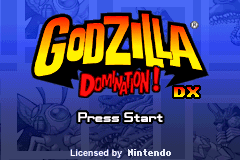
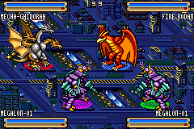
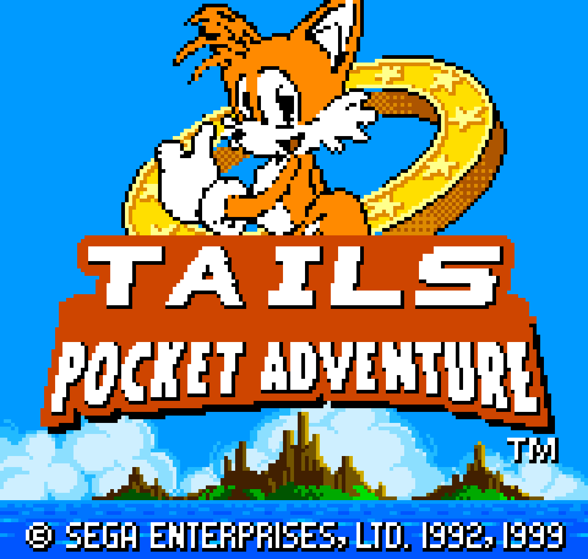
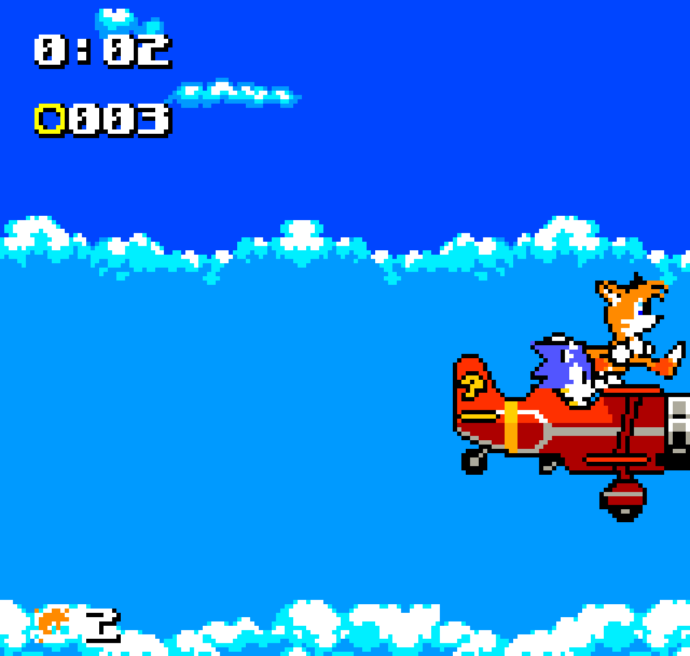

# Game Patches

A collection of retro console ROM hacks, patches (`.bps` / `.ips`), build scripts, and documentation by **AJ Ryan (@ONLYUSEmeFEET)**.

> **Official Releases:** **[ROMhacking.net](https://www.romhacking.net/)** (along with this GitHub repository) is the **official place** where all of my patches are uploaded and maintained. Mirrors or re-uploads on third-party sites (such as ROMhack Plaza) are not maintained by me and may be outdated—please always grab the latest versions from ROMhacking.net or this repository!
>
> **No ROMs are distributed in this repository.** All patches require your own legally obtained clean source ROM. Local ROMs are kept in a `.gitignore`d `roms/` folder.

## Included Patches

| Patch | System | Folder | Formats | Official Page |
| :--- | :--- | :--- | :--- | :--- |
| **Godzilla: Domination! DX v1.0** | Game Boy Advance | [`godzilla-domination-dx/`](godzilla-domination-dx/) | `.bps` | *Ready for Release* |
| **Tails Pocket Adventure v3.4** | Neo Geo Pocket Color | [`tails-pocket-adventure/`](tails-pocket-adventure/) | `.bps` | [ROMhacking.net](https://www.romhacking.net/hacks/10425/) |
| **Rampage - World Tour Unleashed** | Game Boy Color | [`rampage-world-tour-unleashed/`](rampage-world-tour-unleashed/) | `.ips` | [ROMhacking.net](https://www.romhacking.net/hacks/10378/) |
| **Castlevania: Symphony of the Night Reborn v0.2** | Tiger Game.Com | [`castlevania-sotn-reborn/`](castlevania-sotn-reborn/) | `.bps`, `.ips` | [ROMhacking.net](https://www.romhacking.net/hacks/10396/) |
| **Sonic Jam Reborn v0.2** | Tiger Game.Com | [`sonic-jam-reborn/`](sonic-jam-reborn/) | `.bps`, `.ips` | [ROMhacking.net](https://www.romhacking.net/hacks/10416/) |
| **Ranger of Rage 2** | Sega Genesis / Mega Drive | [`ranger-of-rage-2/`](ranger-of-rage-2/) | `.ips` | [ROMhacking.net](https://www.romhacking.net/hacks/4107/) |

## Featured Screenshots — Godzilla: Domination! DX v1.0

| Title Screen (`DX`) | Nighttime Tokyo (`Tokyo 1`) 4P Battle |
| :---: | :---: |
|  |  |

## Featured Screenshots — Tails Pocket Adventure

| Title Screen | Sky Chase (5-1) Tornado Swap |
| :---: | :---: |
|  |  |

## How to Apply Patches
1. Place your clean source ROM in your local `roms/` folder (ignored by Git).
2. Use **[Floating IPS (Flips)](https://www.romhacking.net/utilities/1040/)** or **[RomPatcher.js](https://www.marcrobledo.com/RomPatcher.js/)** to apply the `.bps` (recommended) or `.ips` patch to the matching clean source ROM.
3. See each project folder's README for exact features, controls, credits, and verified checksums.
