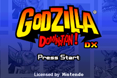
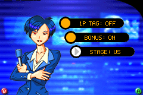
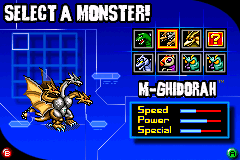
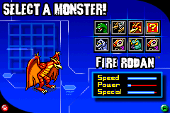
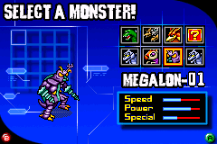
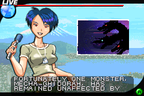
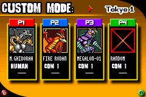
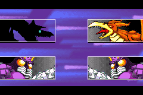
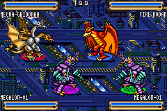
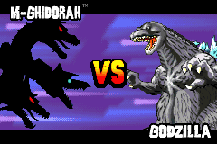

# Godzilla: Domination! DX (v1.0)

**Godzilla: Domination! DX** is a comprehensive Game Boy Advance ROM hack and English localization of **Gojira: Kaijuu Dairantou Advance (Japan)** (`AG4J`) by **AJ Ryan (@ONLYUSEmeFEET)**.

The Japanese release of *Godzilla: Domination!* arrived months after the Western version with exclusive *Godzilla: Tokyo S.O.S.* sprites (Kiryu, Tokyo S.O.S. Godzilla, Tokyo S.O.S. Mothra) and three new gameplay rule modes (**Normal**, **Survival**, and **Adrenaline**), but removed the USA Bonus Stages and locked out the classic Heisei/Millennium sprites. **DX** unites the best of every regional release in English—and expands the game into a **12-fighter roster** with true mirror matches, movie-accurate Mini Mecha-King Ghidorah, Fire Rodan, Eva Unit-01 Megalon, subtle fighter stat trade-offs, and a built-in DX Options menu.

---

## Features

### 1. Full English Localization of `AG4J`
- Complete official USA English script (menus, Connie Matsu GWN news broadcasts, stage intros, endings, and credits) plus newly translated English descriptions for all three Japanese-exclusive rule modes.
- Localized USA-style Title Screen (**Godzilla: Domination! DX** with a custom fiery `DX` badge, `Press Start`, and `Licensed by Nintendo`), Mode Select, Rule Select (`NORMAL RULE`, `SURVIVAL`, `ADRENALINE`), Custom Mode (`CUSTOM MODE:`), Battle Results (`TOTAL SCORE`), Monster Select headers, `RAGE ATTACKS:` (`Lev 1 / Lev 2 / Lev 3`), official distressed Domination-font nameplates, and 12-entity Battle HUD names.

### 2. Japanese-Exclusive Rule Modes Preserved
- **Normal Rule**: Standard gameplay rules.
- **Survival Rule**: No health recovery or continues.
- **Adrenaline Rule**: Special attack gauge fills faster than normal.

### 3. 12-Entity Independent Roster in Custom Mode (True Mirror Matches!)
Cycle **Left / Right** on any Custom Mode player slot (`P1`–`P4`) to pick from **12 completely independent fighters**—allowing up to 4 fighters (including true mirror matches like *Kiryu vs. Classic Mechagodzilla*, *Godzilla '03 vs. Godzilla '99*, or *King Ghidorah vs. Mecha-King Ghidorah*) to battle simultaneously with distinct sprites, non-colliding palettes, Custom Mode names, recolored 2P/3P/4P Versus portraits, official Domination-font 2P VS nameplates, Battle HUD names, and Battle Results mini icons:

| ID | Fighter | Origin / Visual Identity | Base HP | Walk Speed | Role |
| :---: | :--- | :--- | :---: | :---: | :--- |
| `1` | **GODZILLA '03** | *Tokyo S.O.S.* charcoal-gray Godzilla (`AG4J`) | `71` | `0.875` | Balanced all-rounder |
| `2` | **KING GHIDORAH** | Classic golden three-headed dragon | `71` | `1.000` | Balanced aerial bruiser |
| `3` | **RODAN** | Classic brown/gold winged kaiju | `71` | `1.125` | Fast aerial striker |
| `4` | **KIRYU** | *Tokyo S.O.S.* Type-3 Kiryu (`AG4J`) | `71` | `0.750` | Armored brawler |
| `5` | **MOTHRA '03** | *Tokyo S.O.S.* Mothra (`AG4J`) | `71` | `1.000` | Agile flyer |
| `6` | **MEGALON** | Classic green/purple Seatopian beetle | `71` | `0.875` | Balanced grappler |
| `7` | **GODZILLA '99** | *Millennium* USA emerald-green Godzilla | `67` | `0.9375` | Nimbler rushdown |
| `8` | **MECHA-GHIDORAH** | Movie-accurate Mini Mecha-King Ghidorah (titanium-silver middle head/chest/cuffs, emerald cockpit & visor, bronze-gold solar wings, gold outer heads, Shadow MKG VS art) | `77` | `0.90625` | Armored tank |
| `9` | **FIRE RODAN** | Blazing crimson/gold Fire Rodan + recolored VS art | `65` | `1.21875` | Fastest glass cannon |
| `10` | **MECHAGODZILLA** | Classic Heisei USA Mechagodzilla | `76` | `0.71875` | Heavy artillery tank |
| `11` | **MOTHRA '92** | Classic Heisei USA Mothra | `68` | `1.0625` | Agile classic guardian |
| `12` | **MEGALON-01** | Eva Unit-01 purple/emerald Megalon + recolored VS art | `68` | `0.9375` | Berserk rushdown tempo |

### 4. Per-Monster `Select` Switcher in Story, Survival & Adrenaline Modes
- Hover **any of the 6 playable monsters** on Monster Select and press **`Select`** to toggle its DX counterpart independently.
- All Classic USA monster animations (`Godzilla '99`, `Mechagodzilla`, `Mothra '92`) are frame-remapped 1-to-1 to `AG4J` while preserving `AG4J`'s exact 24-byte hitboxes (see [`frame_mappings.md`](frame_mappings.md)).
- Switching updates the live preview sprite, roster mini icon, official Domination-font nameplate (`KIRYU™` ↔ `MECHAGODZILLA™`, `KING GHIDORAH™` ↔ `M-GHIDORAH™`), 2P Giant VS portrait & nameplate, and in-battle HUD name.

### 5. DX Regional Options Menu
Inside **Options**, press **`Select`**, **`L`**, or **`R`** to flip between Standard Options (`Timer`, `Difficulty`, `Ally DMG`) and **DX Options**:
- **`1P TAG: ON / OFF`**: Toggle the Japanese `1P`–`4P` overhead player tags outside Story Mode.
- **`BONUS: OFF / ON`**: Restore the USA Story Mode Bonus Stages (UFO Assault after Stage 2, SDF Jet Assault after Stage 5).
- **`STAGE: JP / US`**: Switch between Japanese randomized Story Mode stage order and USA fixed stage progression.

---

## Screenshots

| Title Screen (`DX`) | DX Options Menu |
| :---: | :---: |
|  |  |

| Monster Select — Mini MKG + Live DX Stats | Monster Select — Fire Rodan + Live DX Stats |
| :---: | :---: |
|  |  |

| Monster Select — Megalon-01 + Big Nameplate | Story Mode — Shadow MKG News & Dialogue |
| :---: | :---: |
|  |  |

| Custom Mode — 12-Fighter `RANDOM` & `Tokyo 1` | 4P VS — Shadow MKG, Fire Rodan & Megalon-01 |
| :---: | :---: |
|  |  |

| Live 4P Battle — Nighttime Tokyo (`Tokyo 1`) | 2P Giant VS — Shadow MKG vs. Godzilla |
| :---: | :---: |
|  |  |

---

## What's New in v1.0
- **Custom Mode 12-Fighter Random Select (`RANDOM` / `?`)**: Cycle past `MEGALON-01` to select `RANDOM` on any player slot (`P1`–`P4`); resolves secretly across all 12 fighters on match start (mirror matches allowed).
- **New Custom Mode Stage — Nighttime Tokyo (`Tokyo 1`) + 8-Stage `Random`**: Appended right after the 7 vanilla stages in Custom Mode (`Tokyo 2..Nova-b`, `Tokyo 1`, `Random`). `Tokyo 1` transforms Tokyo into a midnight metropolis with a deep indigo sky, moonlit streets, glowing warm-yellow lit skyscraper windows, and original Tokyo BGM.
- **Live DX Stat Bars & Unified Story Mode DX Stats**: Pressing `Select` on Single-Player Monster Select now live-updates the **Power** (HP) and **Speed** bars to reflect each DX variant's real trade-offs—and those DX HP & Speed stats now apply in Story Mode battles too.
- **All 12 Unique Big Domination-Font Nameplates**: Every fighter—including `GODZILLA '03`, `MOTHRA '03`, `KIRYU™`, and all 6 DX variants—now has its own unique distressed Domination-font nameplate across Monster Select and 2P Giant VS.
- **Dynamic Story Mode Dialogue Names**: Connie Matsu's GWN broadcasts, mid-stage briefings, and victory endings now call Kiryu `KIRYU` and dynamically update to `GODZILLA '99`, `MECHA-GHIDORAH`, `FIRE RODAN`, `MECHAGODZILLA`, `MOTHRA '92`, or `MEGALON-01` when playing as a DX variant, cleanly re-wrapped to fit the dialogue box.
- **Refined 69-Frame Mini Mecha-King Ghidorah & 4P Shadow MKG Portrait**: Warm titanium center head/neck/chest cuirass, exact emerald eye & chest gem, crimson red organic eyes, metal-lined bronze-gold solar wings, and the official 2P Giant VS Shadow MKG silhouette in 3P/4P VS.

---

## Patching Instructions & Verified Checksums
Apply **`Godzilla Domination DX.bps`** to a clean Japanese ROM using **[Floating IPS (Flips)](https://www.romhacking.net/utilities/1040/)** or **[RomPatcher.js](https://www.marcrobledo.com/RomPatcher.js/)**.

- **Clean Source ROM**: `Gojira - Kaijuu Dairantou Advance (Japan).gba` (`AG4J`)
  - Size: `4,194,304` bytes (4 MB)
  - CRC32: `3157A4FC`
  - MD5: `f05f356facb38a1c330fa3d80ff3bd28`
  - SHA-1: `985599e9f65d58d67170ca9ad3eb406c6ed25217`
- **Patched Output ROM**: `Godzilla Domination DX.gba` (8 MB)
  - Size: `8,388,608` bytes (8 MB)
  - CRC32: `C5BA421E`
  - MD5: `830cb6143f01d350dfbee065d5c0eb0b`
  - SHA-1: `bbf82e33f25595a3f3d6855a10b8b5ceadb60c36`
- **BPS Patch**: `Godzilla Domination DX.bps`
  - Patch CRC32: `2144DF1C` (round-trip verified)

## Building from Source
Requires Python 3.12+ with `keystone-engine` and `Pillow`, plus both clean source ROMs placed in `roms/`:
```bash
python godzilla-domination-dx/build_patch.py \
  --src "roms/Gojira - Kaijuu Dairantou Advance (Japan).gba" \
  --usa "roms/Godzilla - Domination! (USA).gba" \
  --out-rom "roms/Godzilla Domination DX.gba" \
  --out-bps "godzilla-domination-dx/Godzilla Domination DX.bps"
```

## Credits
- **ROM Hack, Assembly Hooks, Pixel Art & Localization**: AJ Ryan (@ONLYUSEmeFEET)
- **Original Game**: WayForward Technologies / Atari / Infogrames / Toho Co., Ltd.
